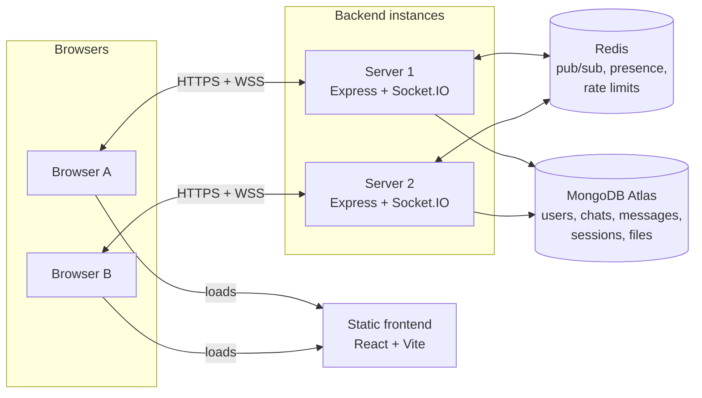
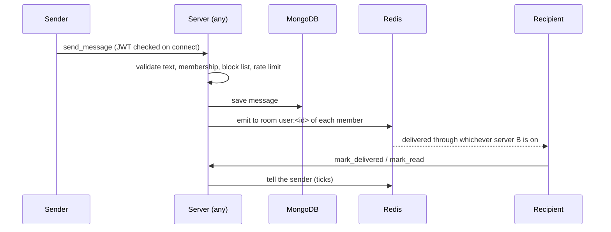

# Architecture

## Overview

Any server can hold any person's connection. When Server 1 emits to a room, the Redis adapter relays it to Server 2, so Browser B still receives it.

## How a message travels

## Data

| Collection | Holds |
|------------|-------|
| User | name, email, password hash, gender, picture, about, blocked list, deletedAt |
| Session | one per logged-in device (so devices can be listed and ended) |
| Conversation | participants, group details, and each person's own state (cleared, hidden, pinned, muted, archived) |
| Message | text, sender, reply, attachment, deleted markers, delivered and read lists |
| Attachment | file bytes with a one-hour expiry until it is attached to a message |

## Real-time rooms

- `user:<id>`: everything addressed to one person on all their devices
- `session:<id>`: one login, so it can be ended instantly
- `conversation:<id>`: typing indicators for the open chat

## Safe re-sending

Every message carries a random `clientId`. If the connection drops and the browser sends the message again, the server finds the message already saved for that sender and `clientId` and returns it instead of saving a second copy. A unique database index on (sender, clientId) closes the remaining race when two copies arrive at the same moment. The browser retries up to three times automatically.

## Design choices

- **User id always comes from the token**, never from the request body.
- **Membership is checked on every read and write** of a conversation, message or file.
- **Per-person state** (clear chat, pin, mute) is stored per person, so one person's actions never change another's view.
- **Redis is shared** for presence and rate limits so the limits hold across servers.
